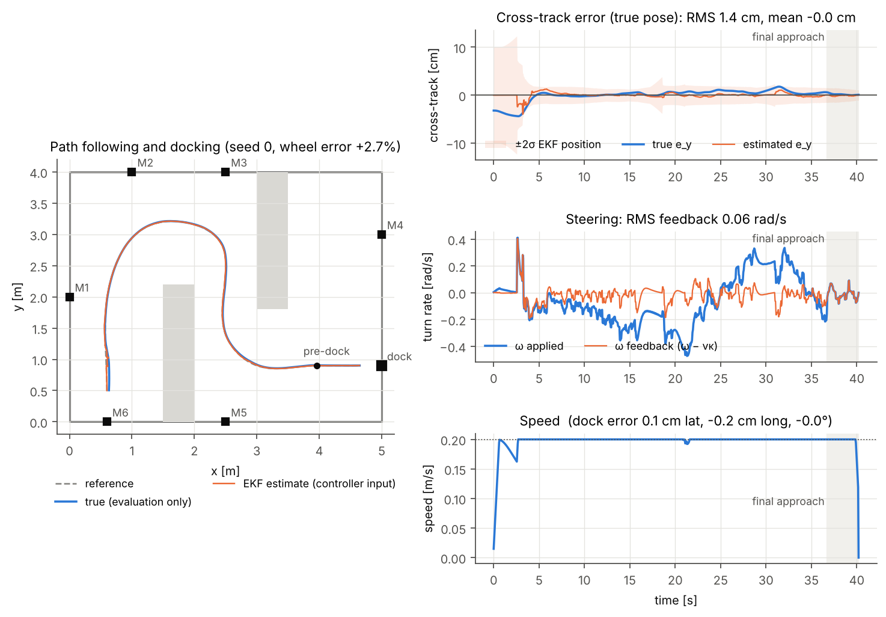
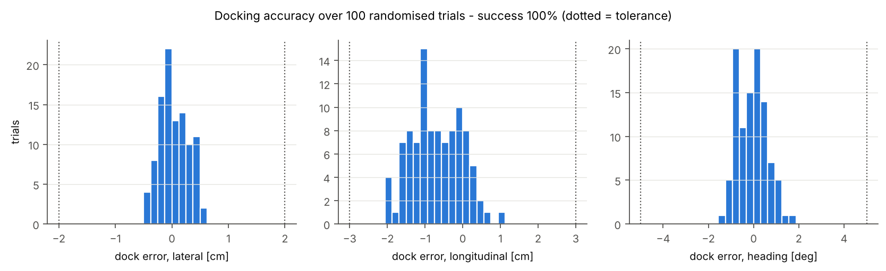
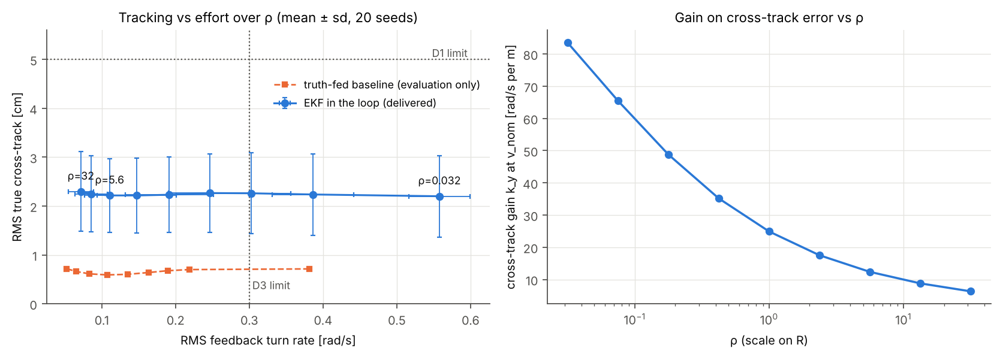
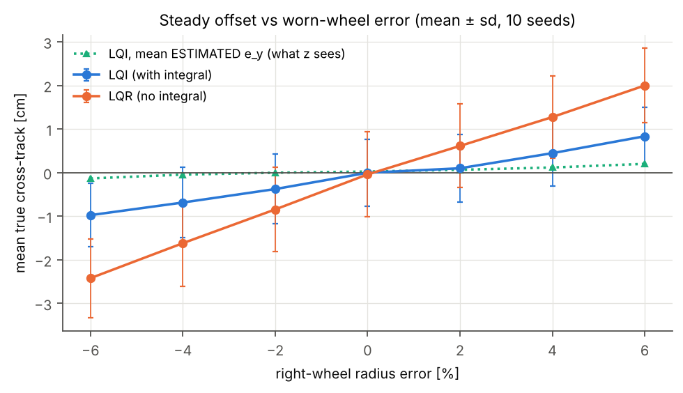
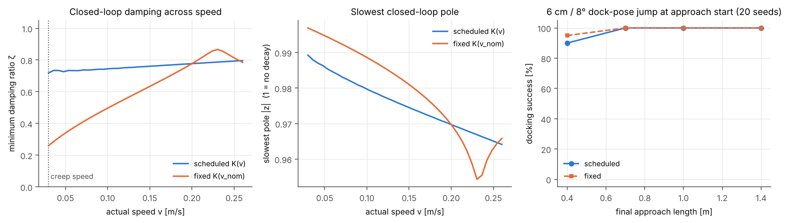

# Part D: Control (Track A, TurtleBot3 visual docking)

A speed-scheduled **LQI path follower** that drives the TurtleBot3 along the planner's waypoints
and docks on the ArUco-marked charging station. It runs **only on the EKF estimate**: ground truth
appears only in the evaluation code, and a test (`tests/test_controller.py`) checks that the controller
package never references it.



---

## 1. Interface (how it plugs into the pipeline)

```python
from tb3_control import Path, PathFollower, dock_poses

pre, dock, heading = dock_poses(marker_xy, marker_facing_angle, standoff=0.35, approach_len=0.70)
path = Path.from_waypoints(waypoints, start_heading, pre, dock, heading)   # waypoints from the LiDAR planner
ctrl = PathFollower(path)

# every T = 0.05 s
v, w, info = ctrl.step(ekf.x, ekf.P)      # x_hat = [x, y, th] in the world frame, P = 3x3 covariance
# send (v, w) to the robot; the EKF should predict with the wheel encoders (what the robot actually did)
```

| File | What it does |
|---|---|
| `tb3_control/params.py` | Every robot and controller number in one place |
| `tb3_control/model.py` | Error model, linearisation, ZOH discretisation, controllability |
| `tb3_control/lqr_design.py` | Bryson weights, discrete LQR (DARE), gain schedule over speed |
| `tb3_control/path.py` | Clamped spline through the waypoints plus a straight docking approach; projection to (e_y, e_th, κ) |
| `tb3_control/controller.py` | `PathFollower`: speed profile, LQI with feed-forward, saturation, anti-windup |
| `sim/` | Test rig: TB3 with worn wheel, motor lag, latency, encoders, ArUco camera, and a stand-in EKF |
| `experiments/run_part_d.py` | Every figure and number in this section |
| `examples/mujoco_hookup.py` | How to drive the MuJoCo TB3 with the controller |

## 2. Model

**Plant.** A differential drive treated as a unicycle, `ẋ = v cos θ, ẏ = v sin θ, θ̇ = ω`, with wheel rates
`ω_R,L = (v ± ωL/2)/r`. Waffle Pi values: r = 0.033 m, L = 0.287 m, v_max = 0.26 m/s, ω_max = 1.82 rad/s.

**Error coordinates.** At the closest point on the path, `e_y` is the signed cross-track error (+ = left) and
`e_θ = θ − θ_path`. The exact dynamics are

```
ė_y = v sin e_θ
ė_θ = ω − κ v cos e_θ / (1 − κ e_y)
```

**Linearisation.** Linearise about e_y = e_θ = 0 and take the curvature feed-forward `vκ` out of the input,
so the controller only designs the feedback turn rate `u = ω − vκ`:

```
d/dt [e_y; e_θ] = [0 v; 0 0][e_y; e_θ] + [0; 1] u
```

**Assumptions:** no wheel slip, wheels follow commands instantly, small errors, constant v over one
sample. The rig deliberately breaks all four (worn wheel, motor lag, latency, slip noise, 10 cm bumps)
so the results show how much each one matters.

**Discretisation.** Exact ZOH at T = 0.05 s gives `Ad = [1 vT; 0 1]`, `Bd = [vT²/2; T]`. The integrator is
added in discrete time **exactly as the code runs it**, `z(k+1) = z(k) + T e_y(k)`, giving the 3-state
augmented model the gain is designed on.

**Controllability.** The rank of `[B AB A²B]` is **1 at v = 0** and **3 for any v > 0**. A stationary TurtleBot can
turn but cannot reduce a lateral error. This sets two design rules: the controller never commands v = 0
before the dock (creep speed 0.03 m/s), and lateral errors must be corrected while the robot still has speed
(Section 5.4).

## 3. Controller design

| Element | Choice | Why |
|---|---|---|
| Law | `ω = vκ − K(v)[e_y, e_θ, z]` | Feed-forward follows the curve; feedback only corrects errors |
| Weights (Bryson) | e_y,max = 5 cm, e_θ,max = 0.15 rad, z_max = 0.05 m·s, u_max = 0.6 rad/s → Q = diag(400, 44.4, 400), R = ρ/u_max² | Each term scaled by what is acceptable for docking at a 2 cm tolerance |
| ρ | **5** (R = 13.9) | Chosen from the sweep in 5.1 |
| Gain at v_nom = 0.2 m/s | **K = [12.96, 2.80, 4.99]**, closed-loop \|z\| = 0.918, 0.970 ± j; ω_n = 0.79 rad/s, ζ = 0.78 | From `scipy.linalg.solve_discrete_are` |
| Gain schedule | K re-solved at 15 speeds from 0.03 to 0.26 m/s and interpolated | A contains v, so one fixed gain is under-damped at low speed (ζ = 0.26 vs 0.72) |
| Speed profile | `v = min(v_nom, √(a_lat/\|κ\|), √(2a·s_remaining))`, floor 0.03 m/s, accel limit 0.3 m/s², 1 s curvature preview | Slows before bends, stops on the dock, never stalls |
| Uncertainty-aware speed | slows if the EKF's 1σ position > 5 cm | Uses P, never truth |
| Saturation | v and ω scaled by the **same** factor to respect wheel and turn-rate limits | Keeps the commanded curvature, so the robot stays on the path geometry |
| Anti-windup | integrator frozen while saturated, unless the error pulls it back; clamp ±0.1 m·s | Stops wind-up on tight turns |
| Docking | straight 0.70 m final approach on the marker normal, stops at 0.35 m standoff | A straight approach means κ = 0 at the dock, so all steering is error correction |

## 4. Results

Full tables are in [`results/results.md`](results/results.md), generated by the same run as the figures.
Specification (team-defined), checked on **100 randomised trials**. Each trial varies the start pose
(±5 cm, ±5°), the worn-wheel error (2–4.5%, either sign) and all noise. These seeds are disjoint from the
20 tuning seeds.

| Req. | Metric | Limit | Result (mean ± sd) | Trials passing | Truth-fed baseline* |
|---|---|---|---|---|---|
| D1 | RMS true cross-track | ≤ 5 cm | 2.23 ± 1.15 cm | 96% | 0.73 cm |
| D2 | \|mean\| true cross-track | ≤ 2 cm | 0.02 ± 0.96 cm (worst 3.11) | 95% | 100% |
| D3 | RMS feedback turn rate ω − vκ | ≤ 0.30 rad/s | 0.109 ± 0.053 rad/s | 99% | 0.098 |
| D4 | Docks within 2 cm lateral / 3 cm longitudinal / 5° | ≥ 95% | **100%** | – | 100% |

95th-percentile dock error: **0.47 cm lateral, 1.66 cm longitudinal, 1.11°**. Mean time to dock is 41 s.

\*Truth-fed baseline: the same controller given ground truth instead of the EKF. **Evaluation only**, used to
separate control error from estimation error.



## 5. Analysis

### 5.1 Choosing ρ: tracking is limited by estimation, not by the controller


Sweeping ρ over three decades changes k_y from 84 to 6 and cuts steering effort by 8×, but **with the EKF in
the loop RMS cross-track stays at 2.2–2.3 cm**. The controller can only drive the *estimated* error to zero,
and the EKF's own position error is 2.6 cm RMS. With truth fed in, the same controller reaches 0.6–0.7 cm,
and that curve is U-shaped:

- **Small ρ:** the wheels saturate (40% of samples at ρ = 0.03) and the high gain fights the 50 ms latency.
- **Large ρ:** the controller lags on curves.

ρ = 5 sits at the bottom of the truth-fed curve and uses ~40% less effort than ρ = 1 (0.109 rad/s in the 100-trial evaluation vs 0.191 at ρ = 1 in the sweep), at no cost in tracking.
**Takeaway:** better tracking has to come from the estimator (more markers, better odometry noise model),
not from a stiffer controller.

### 5.2 Integral action and the worn wheel


A worn wheel adds a yaw-rate disturbance `d ≈ vε/L`. Without the integrator, the steady offset grows to
2.0 cm at +6%. With it, the offset drops to 0.8 cm.

The green line shows why the offset isn't zero: the integrator drives the **estimated** mean error to ≤ 0.2 cm,
exactly as designed. The rest is **bias in the estimate**, because the EKF's odometry model doesn't know about
the worn wheel either. This is the most likely cause of the D2 failures (5 of 100 trials). Recommended fix for the
estimator: add the wheel-radius ratio as an EKF state.

### 5.3 Gain scheduling: matters on paper, rarely in this mission


At the 0.03 m/s creep speed, the fixed cruise gain gives ζ = 0.26 and the scheduled gain ζ = 0.72. In the
simulations both dock equally well, because the robot spends only **1.1%** of a run below 0.1 m/s. The
deceleration profile only bites in the last ~7 cm. The schedule is kept because it costs nothing and protects
against slower approach profiles. We report honestly that it is not what makes the docking work here.

### 5.4 How long must the final approach be?
We shift the dock pose by 6 cm / 8° as the approach begins, as when the camera re-estimates the marker up close.
That gives 90% success at 0.4 m (the heading is still 4° off on arrival) and 100% from 0.7 m. Mean lateral error
falls to 0.19 cm at 1.4 m. Because lateral authority vanishes as v → 0 (Section 2), the approach has to be long
enough for the heading transient to finish *before* the robot slows. **0.7 m is the shortest length that met
D4 here.**

### 5.5 Robustness
- **Latency:** at 0–300 ms, tracking holds at 2.4–2.5 cm and every trial docks, but steering effort doubles
  (0.117 → 0.249 rad/s). By 300 ms it is near the D3 limit.
- **Motor lag:** a time constant of 0.02–0.4 s has no measurable effect.
- **Bump:** a 10 cm / 10° shove peaks at 9 cm true error, and the robot still docks
  (`results/fig5_bump.png`). Recovery waits ~2.5 s, until a marker comes into view and the EKF notices. The
  controller can only correct what the estimator sees.

### 5.6 Limits of this evaluation
- The rig is kinematic (no wheel–ground dynamics), not the MuJoCo scene. `examples/mujoco_hookup.py` needs
  running on the team's MJCF to confirm the numbers.
- The estimator is a stand-in. Its odometry noise is inflated (k = 0.15) to cover the wheel bias; at k = 0.03
  it diverged (Section 5.2). Rerun with the team's EKF.
- One room, one set of waypoints, one dock. The spec limits are the team's own choice.

## 6. Run it

```bash
pip install -r requirements.txt
python tests/test_controller.py          # 8 checks, ~2 s
python experiments/run_part_d.py         # all figures + results/results.md, ~4 min
python experiments/run_part_d.py --quick # smoke test, ~1 min
```

Code adapted from the Weeks 5–8 tutorials (unicycle error model, ZOH, dlqr, integral action,
range-bearing EKF structure).
